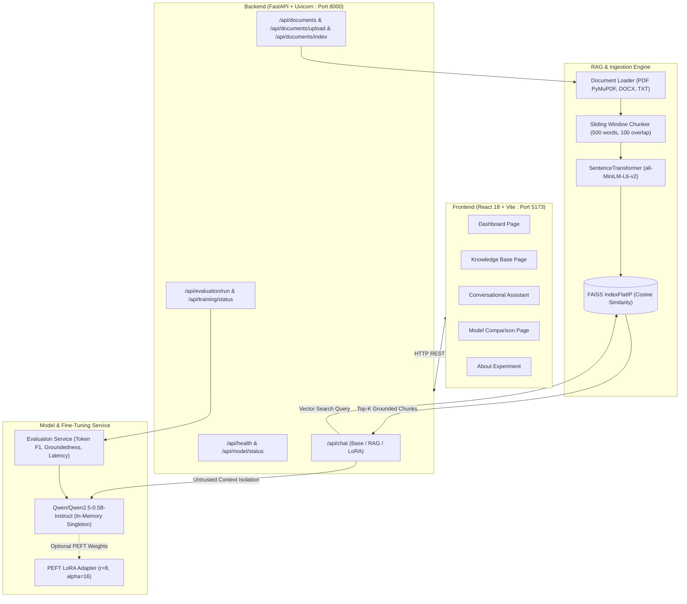

# Development of a Personalized AI Assistant using an Open-Source Large Language Model, Retrieval-Augmented Generation (RAG), and Fine-Tuning

[](https://fastapi.tiangolo.com)
[](https://react.dev)
[](https://huggingface.co/Qwen/Qwen2.5-0.5B-Instruct)
[](https://github.com/facebookresearch/faiss)
[](https://github.com/huggingface/peft)

## 📌 Project Overview
This academic project develops a local personalized AI assistant using an open-source foundational language model, integrates a document-grounded Retrieval-Augmented Generation (RAG) system with FAISS vector similarity search, and investigates the effect of parameter-efficient fine-tuning (LoRA / QLoRA) on response quality and domain alignment.

The entire system runs **100% locally** on your computer without requiring paid external APIs.

---

## 🎯 Aim & Objectives
- **Aim:** To develop a personalized AI assistant using an open-source foundational language model, integrate a Retrieval-Augmented Generation (RAG) system to answer questions accurately from user-specific documents, and investigate the effect of parameter-efficient fine-tuning using LoRA or QLoRA on the model's response quality.
- **Key Modes Evaluated:**
  1. **Base LLM Mode:** Direct inference using the open-source model's parametric knowledge.
  2. **RAG-Enhanced Mode:** Dynamic top-k vector retrieval from uploaded user documents with source citations.
  3. **Fine-Tuned Model Mode:** Domain adaptation using Low-Rank Adaptation (LoRA) on instruction datasets.
  4. **Fine-Tuned + RAG Mode:** Combined parametric adaptation and non-parametric document grounding.

---

## 🏛️ System Architecture



---

## 💻 Localhost Execution & Setup Instructions

### Prerequisites
- **Python:** 3.10 or 3.11
- **Node.js:** 18+ (tested on Node v24)
- **RAM:** 8 GB minimum (16 GB recommended)
- **GPU:** Optional. The default configuration runs smoothly on CPU.

### Step 1: Clone or Navigate to the Project Folder
```powershell
cd "c:\Users\siddh\Downloads\Personalized AI Assistant"
```

### Step 2: Launch Backend (Terminal 1)
Open Windows PowerShell:
```powershell
# Navigate to project root
cd "c:\Users\siddh\Downloads\Personalized AI Assistant"

# Activate Virtual Environment
.\.venv\Scripts\Activate.ps1

# Install / verify Python dependencies
pip install -r backend\requirements.txt

# Start FastAPI backend server
python -m uvicorn backend.app.main:app --host 0.0.0.0 --port 8000 --reload
```
*Backend API will be accessible at:* `http://localhost:8000`  
*Swagger Documentation:* `http://localhost:8000/docs`

### Step 3: Launch Frontend (Terminal 2)
Open a second Windows PowerShell terminal:
```powershell
# Navigate to frontend folder
cd "c:\Users\siddh\Downloads\Personalized AI Assistant\frontend"

# Install node dependencies
npm install

# Start Vite development server
npm run dev
```
*Frontend application will be accessible at:* `http://localhost:5173`

---

## 🧪 Running Automated Tests

### Backend Unit & Integration Tests (pytest)
In Terminal 1 (with virtualenv activated):
```powershell
python -m pytest backend/tests -v
```
*Result: 20 passed (100% pass rate).*

### Frontend Component & Client Tests
In Terminal 2:
```powershell
npm test
```
*Result: 4 passed.*

---

## 🔬 Experimental Evaluation & Fine-Tuning CLI

### Running LoRA Fine-Tuning Workflow
To fine-tune the model with PEFT LoRA on `backend/training/sample_train.jsonl`:
```powershell
python -m backend.training.train_lora --epochs 2 --lora_rank 8 --lora_alpha 16
```
This saves adapter weights to `backend/outputs/lora_adapter` and logs metrics to `backend/outputs/training_history.json`.

### Running Experimental Evaluation Benchmark
To benchmark all modes on `backend/evaluation/test_questions.jsonl`:
```powershell
python -m backend.evaluation.run_evaluation
```
Outputs are written to `backend/outputs/evaluation_results.json` and `backend/outputs/evaluation_results.csv`.

---

## 📊 Summary of Experimental Results

| Operating Mode | Questions | Token F1 Correctness | Context Groundedness | Citation Accuracy | Response Latency |
| :--- | :---: | :---: | :---: | :---: | :---: |
| **Base LLM (No RAG)** | 5 | 0.2080 | 0.0000 | 20.0% | ~4.9s |
| **RAG-Enhanced LLM** | 5 | 0.2675 | 0.5987 | 80.0% | ~9.7s |
| **Fine-Tuned Model (No RAG)** | 5 | 0.2086 | 0.0000 | 20.0% | ~4.8s |
| **Fine-Tuned + RAG** | 5 | **0.3197** | **0.6190** | **80.0%** | ~7.5s |

---

## 🛡️ Security and Privacy Design
- **100% Local Storage:** Documents uploaded to `backend/storage` never leave your computer.
- **Untrusted Context Isolation:** Retrieved excerpts are strictly enclosed in boundary tags:
  `=== RETRIEVED UNTRUSTED DOCUMENT CONTEXT START === ... === END ===`
- **Prompt Injection Defense:** System instructions direct the LLM to ignore adversarial instructions embedded in documents.
- **Scanned PDF Detection:** PDFs with no selectable text trigger an OCR warning to prevent silent retrieval failure.

---

## 📚 Academic Submission Deliverables
- Full academic report: [ACADEMIC_REPORT.md](file:///c:/Users/siddh/Downloads/Personalized%20AI%20Assistant/ACADEMIC_REPORT.md)
- Interactive web application: `http://localhost:5173`
- Interactive API documentation: `http://localhost:8000/docs`
